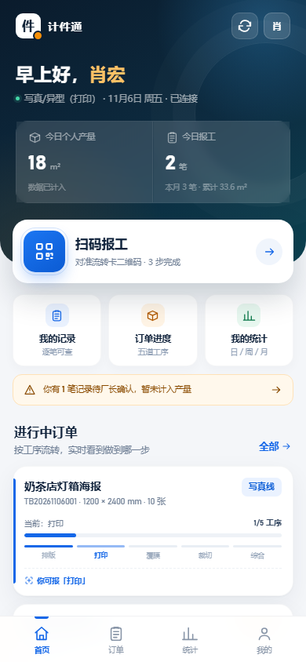
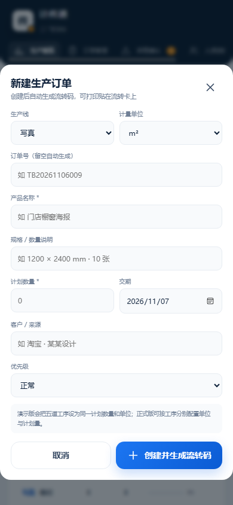

# 计件通 · 工厂个人计件统计

> 双线五工序，扫码即报工；工人看见自己的件数，厂长看见真实的生产进度。
>
> 演示版 v1.0.3 · 生产版 v2.0.9

这是一个**可以直接在手机浏览器操作的高保真 MVP**，基于《工厂计件统计软件设计方案（双线五工序）》和 17 人花名册实现。它用于验证流程、界面和现场操作习惯，正式上线还需要接入后端与账号体系。



## 0. 生产版（多人共享，上线用）

厂长在电脑上看，员工用自己手机登录报工，数据统一保存在服务器。

### 最快启动（厂内局域网）

1. 双击 `启动生产版.bat`（首次会自动安装 FastAPI 依赖）。
2. 厂长打开 `http://127.0.0.1:8787`，账号 `admin`。
3. 初始密码在 `data\管理员初始密码.txt`。
4. 17 名员工的工号和初始 PIN 在 `data\员工初始账号.csv`。
5. 手机连同一 Wi-Fi，打开 `http://服务器IP:8787`。
6. 登录页可点「查看初始账号 / 密码」，直接看到 17 人 PIN 和管理员密码，点一行即可登录。

> 账号显示只适合首次部署：发完 PIN 后建议删除 `data\员工初始账号.csv` 和 `data\管理员初始密码.txt`；公网 Docker 已默认关闭该显示。

注意：局域网 HTTP 下浏览器不允许调用相机，员工可输入订单号/流转码报工。
如果要手机扫码，必须部署 HTTPS，见 [生产版上线部署说明](docs/生产版上线部署说明.md)。

### 本地 HTTPS（手机扫码，不租云）

1. 固定服务器电脑的局域网 IP，例如 `192.168.116.22`。
2. 双击 `启动生产版-HTTPS.bat`。
3. 手机先打开 `http://192.168.116.22:8788/` 安装根证书（每台一次）。
4. 手机打开 `https://192.168.116.22:8443`，即可扫码。
5. 数据仍在 `data\jitong.db`，断网也能用。

完整步骤和 iPhone/Android 安装方法见 [本地HTTPS扫码部署说明](docs/本地HTTPS扫码部署说明.md)。

> 新建订单已改为排版人员专属：王坚、张知亮、朱宗耀、胡汝奇、喻宏伟登录手机端后，在首页点「新建订单」；表单为单位、米数、订单号、备注，产线按单位自动归类（m²→写真，件/套/块→亚克力）。管理员也不能建单，但可在「人员技能 → 建单权限」中勾选/取消人员，权限保存在数据库。系统会阻止取消最后一名建单人员。
>
> 修改管理员密码或员工 PIN：双击 `设置密码.bat`，输入 `admin` 或员工工号，按提示输入两次。不要直接编辑 `data` 下的初始密码文件。

### 云服务器 + 域名 HTTPS


服务器安装 Docker 后：

```bash
cp .env.example .env
# 修改 DOMAIN 和 JITONG_ADMIN_PASSWORD
docker compose up -d --build
```

Caddy 会自动申请 HTTPS 证书，员工手机打开 `https://你的域名` 即可扫码。

### 生产版和演示版的区别

| | 演示版 | 生产版 |
| --- | --- | --- |
| 启动 | `启动计件通.bat` | `启动生产版.bat` |
| 数据 | 各自浏览器 localStorage | 服务器 SQLite，所有人共享 |
| 登录 | 点名字即进 | 工号 + PIN；admin + 密码 |
| 手机扫码 | 仅演示 | HTTPS 下可用相机 |
| 适用 | 看流程、培训、演示 | 工厂正式计件 |

---

## 演示版（v1.0.3，单机体验）


## 1. 现在就能运行

### 电脑 + 手机（推荐）

1. 双击 `启动计件通.bat`。
2. 电脑浏览器会自动打开 `http://127.0.0.1:8787`。
3. 手机与电脑连接**同一个 Wi-Fi**，在手机浏览器输入启动窗口里显示的局域网地址，例如：
   `http://192.168.1.23:8787`
4. 如果手机打不开，检查 Windows 防火墙是否允许 Python 访问“专用网络”。

### 只用电脑

```powershell
cd "D:\工厂个人计件软件"
python start.py
```

> 环境要求：Python 3.11+。项目**没有第三方依赖**，不需要 `pip install`。
> 二维码生成库已经放在 `app/vendor/qrcode.js`，离线也能用。

### 演示账号

| 账号 | 岗位 | 能体验什么 |
| --- | --- | --- |
| 肖宏 | 写真 / 异型（打印） | 写真打印报工、超报待确认 |
| 王坤 | 裁切（激光切割） | 亚克力裁切报工 |
| 梁建华 | 过膜过板 | 写真覆膜 / 亚克力过胶 |
| 肖尾珍 | 综合岗位 | 双线综合工序 |
| 李厂长 | 厂长 · 管理员 | 管理端、订单、异常、人员、报表 |

点击“查看全部 17 名员工”可以切换花名册中的任意员工。

## 2. 已实现的完整体验

### 员工端（手机优先）

- **登录 / 身份切换**：17 名员工 + 1 个厂长账号，按岗位显示可报工序。
- **首页**：今日个人产量、今日报工笔数、本月累计、待确认提醒、进行中订单、最近报工。
- **扫码自动报工**：扫描流转卡后，系统自动确定该员工可做的第一道未报工序，按订单米数/数量直接提交；不再显示手动数量确认页。
- **自动校验**：技能、上游顺序、重复扫码仍在服务端校验；没有可报工序或订单已完成会明确提示。
- **提交成功**：显示订单、工序、数量、时间、记录编号和今日累计。
- **我的记录**：按日期分组、状态筛选、逐笔详情、申请冲销 / 更正。
- **我的统计**：今日 / 本周 / 本月，按工序拆分，平方米、件、套分单位统计，不混加。
- **订单进度**：搜索订单、五道工序时间线、真实二维码流转卡、可报工序入口。
- **个人中心**：技能标签、本月数据、消息、同步状态、管理入口、使用帮助、切换账号。
- **PWA**：支持“添加到主屏幕”（HTTPS 或 localhost 下生效）。

### 管理端（电脑 / 手机自适应）

- **生产概览**：今日总产出、报工笔数、进行中订单、待确认异常、双线产出、五工序在制进度。
- **订单管理**：查看订单、打印流转卡、看工序进度；新建订单由排版人员在手机端完成。
- **异常确认**：超报 / 补录确认计入、驳回冲销；更正申请审批。
- **人员技能**：双线五工序覆盖矩阵，自动标出岗位覆盖缺口，并显示全线多能工。
- **报表导出**：今日明细、本月明细、员工产量汇总、订单进度，导出 CSV（Excel 可直接打开）。

## 3. 关键业务规则

| 规则 | 当前实现 |
| --- | --- |
| 计量单位 | 每条记录保存独立 `unit`，平方米 / 件 / 套不直接相加 |
| 上游校验 | 同单位时，累计完成 ≤ 上游已转数量 |
| 超报 | 不硬拦截，转为「待厂长确认」，确认前不计入产量 |
| 防重复 | 同人 / 同订单 / 同工序 / 同数量，10 分钟内二次确认 |
| 技能权限 | 非本工序技能人员默认不能报工，厂长可查看覆盖缺口 |
| 更正 | 已计入记录不能删除，只能申请冲销，保留原记录与审批痕迹 |
| 统计口径 | 仅 `已计入` 参与统计；待确认、已冲销不计入 |

## 4. 重要说明（演示版边界）

这是一个**前端演示版**，不是生产系统：

- 数据保存在当前浏览器的 `localStorage`，换手机、换浏览器或清理缓存后不会保留。
- 没有真实登录、服务端权限、数据库和多设备同步。
- 相机扫码需要 HTTPS 或 localhost；通过局域网 HTTP 打开时，请使用“演示流转卡”或手动输入。
- iOS Safari 不支持 `BarcodeDetector`，相机识别会降级；正式版建议做微信小程序。
- “新建订单”演示版把五道工序设为同一单位；正式版应按工序配置单位（尤其是综合岗位按件、前道按平方米）。

正式上线建议：

```text
微信小程序（工人端） + Vue 3 管理后台
        ↓ HTTPS
FastAPI / Spring Boot + PostgreSQL + Redis + 对象存储
        ↓
二维码签名、幂等提交、离线队列、RBAC、审计日志、每日备份
```

## 5. 花名册与岗位映射

演示数据来自你提供的 17 人花名册：

| 岗位 | 人数 | 当前映射 |
| --- | ---: | --- |
| 综合岗位 | 5 | 写真 / 亚克力 第 5 道，可跨线 |
| 裁切（激光切割） | 4 | 亚克力 第 4 道；黄伟、刘浩兼写真第 4 道 |
| 写真 / 异型（排版） | 2 | 写真 第 1 道 |
| 亚克力排图 | 2 | 亚克力 第 1 道 |
| 过膜过板 | 2 | 写真第 3 道 + 亚克力过胶（假定兼岗） |
| 写真 / 异型（打印） | 1 | 写真 第 2 道 |
| UV 打印 | 1 | 亚克力 第 2 道 |

**当前已确认的技能授权：**

1. **写真裁切**：由黄伟、刘浩负责，同时保留亚克力裁切权限。
2. **全线多能工**：王坚、张知亮负责写真线 + 亚克力线全部五道工序。
3. **仍需确认**：亚克力过胶目前按“过膜过板”兼岗；排版/裁切的计量单位需要业务最终确认。

## 6. 项目结构

```text
D:\工厂个人计件软件\
├─ app\                     手机端 + 管理端（同一套界面，服务端注入生产模式）
│  ├─ index.html
│  ├─ styles.css
│  ├─ core.js               数据、业务计算、通用组件
│  ├─ pages-worker.js       登录 / 首页 / 扫码 / 报工 / 成功
│  ├─ pages-main.js         记录 / 统计 / 订单 / 我的 / 管理端
│  ├─ app.js                交互、弹窗、导出、API、启动
│  ├─ vendor\qrcode.js      二维码生成（MIT）
│  ├─ vendor\jsQR.js        手机扫码识别（MIT）
│  ├─ manifest.webmanifest
│  ├─ sw.js
│  └─ icons\
├─ server\                   生产版后端（FastAPI + SQLite）
│  ├─ main.py                API、登录、静态页面
│  ├─ service.py             报工校验、订单、审批
│  ├─ db.py                  数据库、17 人初始化
│  ├─ security.py            PIN 哈希、会话
│  └─ requirements.txt
├─ data\                     生产数据（首次启动生成，含账号，勿提交）
├─ certs\                    本地 HTTPS 证书（含私钥，勿外发）
├─ backups\                  每日备份
├─ dist\                     可直接发给别人的交付包
│  ├─ 计件通-单文件演示版.html
│  ├─ 计件通-单文件演示版.zip
│  └─ 计件通-生产版-交付包.zip
├─ docs\
│  ├─ 生产版上线部署说明.md
│  ├─ 工厂个人计件软件_手机端设计方案.docx
│  ├─ 工厂个人计件软件_手机端设计方案.pdf
│  ├─ diagrams\             设计示意图
│  └─ preview-*.png         界面预览
├─ tools\                   构建、备份、打包脚本
├─ Dockerfile               云服务器镜像
├─ docker-compose.yml
├─ Caddyfile                自动 HTTPS
├─ .env.example
├─ start.py                 演示版本地服务器
├─ 启动计件通.bat            演示版
├─ 启动生产版.bat            生产版 HTTP（厂内手动输单号）
├─ 启动生产版-HTTPS.bat      生产版 HTTPS（手机扫码）
├─ 生产版使用说明.txt
└─ README.md
```

## 7. 开发与自测

```powershell
# 安装测试依赖
python -m pip install -r requirements-dev.txt

# 自动化测试（使用临时数据库，不会碰 data）
python -m pytest

# 启动演示版
python start.py

# 语法检查（可选，需要 Node.js）
node --check app\core.js
node --check app\pages-worker.js
node --check app\pages-main.js
node --check app\app.js
```

浏览器开发者工具中清除站点数据，即可恢复初始演示数据；也可以在管理端「报表导出 → 恢复演示数据」重置。

## 8. 下一步

- [ ] 与厂长确认岗位覆盖、计量单位和审批人。
- [ ] 用真实流转卡在 1 个班组试运行 3 天。
- [ ] 接入后端与微信登录，做真实二维码签名。
- [ ] 增加离线队列、照片证据、设备绑定和异常风控。
- [ ] 试点 1 个月“系统 + 手工”双轨，核对差异后全员推广。

详细的产品、交互、数据模型、技术架构与实施计划见：
- `docs\工厂个人计件软件_手机端设计方案.docx`
- `docs\工厂个人计件软件_手机端设计方案.pdf`（手机直接打开）


## 9. 常见问题

### 点击「新建订单」没有反应

先按 `Ctrl + F5` 强制刷新一次。旧版本可能被浏览器缓存，页面还是旧的脚本。

如果仍然没有反应：

1. 用李厂长账号进入「我的 → 使用帮助 → 清除缓存并刷新」。
2. 或关闭标签页，重新打开 `http://127.0.0.1:8787`。
3. 打开 F12 控制台，把红色报错发给我。

正常点击后，会从底部弹出「新建生产订单」表单：



### 手机打不开

- 确认手机与电脑连的是同一个 Wi-Fi。
- 确认 Windows 防火墙允许 Python 访问“专用网络”。
- 用启动窗口里显示的局域网地址，不要用 `127.0.0.1`。

### 相机扫码没反应

浏览器只在 HTTPS 或 localhost 下允许调用相机。局域网 HTTP 访问时，请使用「演示流转卡」或手动输入订单号。


## 10. 把软件给别人

### 只想让对方试用、看流程（最推荐）

把下面这个压缩包发给对方：

`dist\计件通-单文件演示版.zip`

对方解压后，双击 `计件通-单文件演示版.html`，用 Chrome 或 Edge 打开即可。

- 不需要安装 Python
- 不需要启动服务器
- 断网也能打开
- 报工、订单、统计、异常确认、CSV 导出都能操作
- 数据只保存在对方当前浏览器，换电脑/换浏览器不会同步

单文件版适合给客户、领导、同行演示，不适合作为正式生产系统。

### 想让对方在工厂里正式使用

不能只发这个文件夹。当前版本是前端演示版：

- 每台手机的数据各自保存在自己的浏览器里，互相不共享；
- 没有账号体系、服务端权限和数据库；
- 相机扫码/PWA 需要 HTTPS；
- 多人同时报工、厂长看全厂数据，必须有后端。

正式交付需要部署：

1. 云服务器或厂内小主机；
2. FastAPI / Spring Boot + PostgreSQL 后端；
3. HTTPS 域名；
4. 微信小程序或 H5 登录；
5. 员工账号、技能矩阵、审批人；
6. 每日备份和试点培训。

设计方案第 8 章有完整技术架构，可以按那份方案继续开发。

### 想把源码交给开发

直接发送整个 `D:\工厂个人计件软件` 文件夹，或打包成 zip。对方需要：

- Python 3.11+
- 双击 `启动计件通.bat`
- 先看 `README.md`，再看 `docs\工厂个人计件软件_手机端设计方案.docx`

不要把 `data`、浏览器缓存或 `.cdp-profile` 一起发出去；当前项目没有这些目录。
