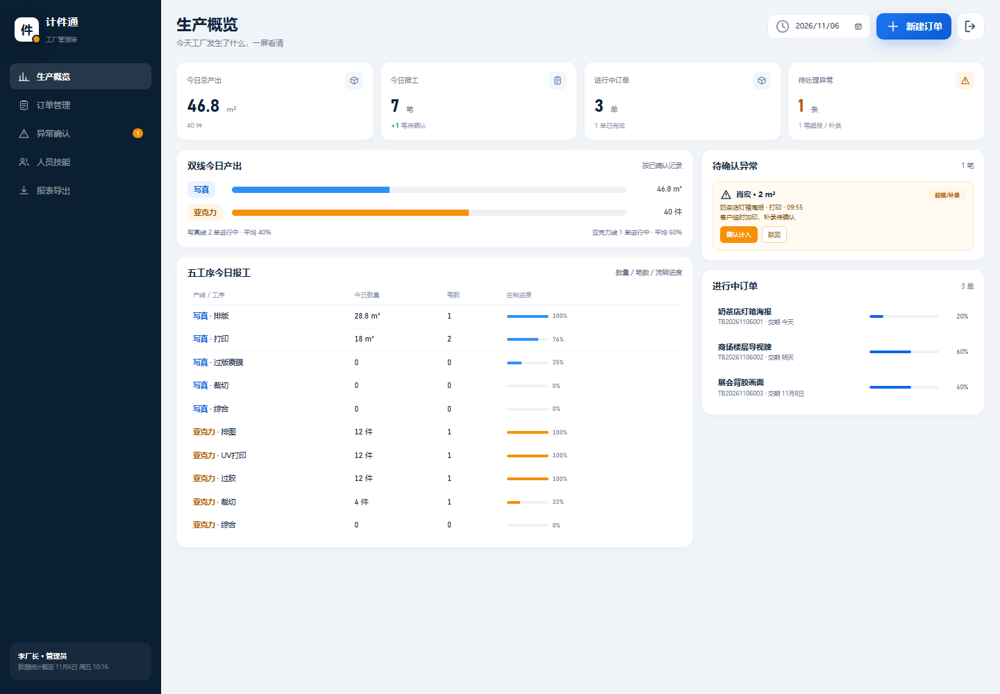
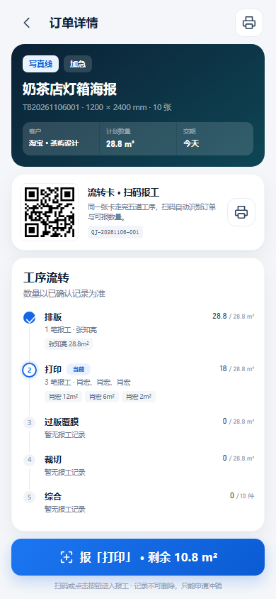
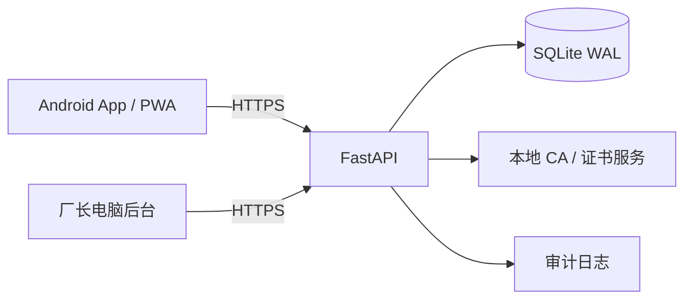

# 计件通 · 工厂计件生产管理系统

一个面向小型工厂的轻量级计件生产系统：员工用手机扫码报工，厂长在电脑上管理订单、人员、工序和产量。

项目从真实的 17 人工厂场景出发，重点解决三件事：

- 员工能快速完成报工，少点几下；
- 多人工序能按实际参与人数公平分产量；
- 厂长能看到真实的生产进度，而不是事后补表。

> 适合作为全栈 / 业务系统方向的面试项目展示。  
> 技术栈：FastAPI · SQLite · 原生 JavaScript PWA · Android WebView

---

## 1. 项目亮点

### 动态工艺路线

- 写真线默认 6 道工序；
- 亚克力线支持多条工艺路线；
- 管理员可以新增、修改、排序、停用工序和路线；
- 新订单创建时复制路线快照，历史订单不受后续修改影响。

### 技能驱动的报工权限

- 每个员工按“工序名称”授权，而不是固定第几道；
- 员工扫码后只看到自己有权限的工序；
- 支持旧数据兼容和技能迁移；
- 管理端可新增、改名、停用工序，并调整员工技能。

### 多人合报与平分

针对写真过板、写真综合、亚克力激光切割等多人协作工序：

- 第一个员工扫码开组；
- 后续员工扫码加入；
- 下一道工序开始或厂长完成订单时自动结束；
- 按实际参与人数平分总数量；
- 结束前不产生正式报工，避免中途反复改数。

### 移动端优先

- H5/PWA：员工手机浏览器直接使用；
- Android：原生 WebView + 扫码；
- 厂长端：电脑后台为主，手机可查看订单和完成订单；
- 本地 HTTPS 证书引导，支持厂内局域网扫码。

### 可追溯的数据设计

- 报工记录软删除，保留审计；
- 订单作废而非物理删除；
- 关键操作写审计日志；
- SQLite WAL 模式，适合单机小规模并发。

---

## 2. 界面预览

| 员工首页 | 厂长概览 |
| --- | --- |
|  |  |

| 新建订单 | 订单详情 |
| --- | --- |
|  |  |

---

## 3. 系统架构



### 技术栈

| 层 | 技术 |
| --- | --- |
| 后端 | Python 3.13 · FastAPI · Uvicorn |
| 数据 | SQLite（WAL） |
| 前端 | 原生 JavaScript · HTML/CSS · PWA |
| 安卓 | Java · WebView · ZXing |
| 部署 | Windows 本地服务 / Docker / Caddy |
| 测试 | Pytest |

---

## 4. 核心业务模型

### 订单与路线

```text
production_jobs
  └─ job_steps          创建订单时复制的工序快照
       └─ piece_records 每个员工的实际报工记录

routes
  └─ route_steps        管理员可维护的路线模板
```

路线修改只影响新订单；已经创建的订单保留自己的工序快照。

### 合报状态机

```text
open
  ├─ 员工加入
  ├─ 下一道工序开始 → 自动结束
  ├─ 厂长手动结束
  └─ 完成订单 → 结束最后一道

closed
  └─ 生成每个参与人的正式报工记录
```

合报结束时按实际人数平分，最后一名参与人补足小数差额，保证总量准确。

### 权限模型

- 员工：按工序技能决定可报工序；
- 建单人：可创建订单、管理自己的订单；
- 厂长：全量订单、人员、技能、路线、报表；
- 关键操作：服务端校验 + 审计日志。

---

## 5. 我重点解决的技术问题

### 1. 从固定五道工序迁移到可配置路线

最初的系统把“第几道工序”写死在前端和后端。  
改造后引入路线模板和订单工序快照，解决：

- 不同产品走不同路线；
- 修改路线不影响历史订单；
- 前端不再依赖固定步骤数组。

### 2. 多人合报的并发与一致性问题

多人扫码不能简单地“每扫一次生成一条记录”，否则会出现：

- 数量重复计算；
- 中途加入导致已确认记录被改；
- 下一道开始时上一道还没结束。

最终采用“合报组 + 结束时结算”的状态机：

- 加入阶段不写正式产量；
- 结束时一次性生成记录；
- 唯一约束防止同一人重复加入；
- 订单完成时做工序完整性检查。

### 3. 本地 HTTPS 与安卓证书信任

工厂没有公网域名，但手机扫码必须使用 HTTPS。

实现方式：

- 本地 CA 签发服务器证书；
- 8788 端口提供 CA 下载页；
- Android 首次配置时下载并信任 CA；
- iPhone 通过描述文件安装并手动开启完全信任。

这部分也让我处理了不少真实设备兼容问题。

### 4. 旧数据兼容

系统从旧的“产线 + 第几道”技能模型迁移到“工序名称”模型。

策略：

- 新订单优先使用新工序技能；
- 旧订单回退到旧技能；
- 增加迁移映射，避免升级后员工突然无法报工；
- 管理端提供技能查看和修正入口。

---

## 6. 快速开始

### 环境

- Python 3.11+
- Windows / macOS / Linux

### 启动后端

```bash
python -m venv .venv
# Windows
.venv\Scripts\activate
# macOS / Linux
source .venv/bin/activate

pip install -r server/requirements.txt
python -m server.main
```

默认访问：

```text
https://127.0.0.1:8443/
```

首次启动会在 `data/` 下生成 SQLite 数据库。  
本地 HTTPS 证书会在 `certs/` 下生成。

> 管理员初始密码、员工 PIN 等敏感配置不会提交到仓库。

### 运行测试

```bash
pip install -r requirements-dev.txt
pytest
```

---

## 7. 项目结构

```text
.
├─ app/                 H5 / PWA 前端
│  ├─ app.js            交互、API、弹窗
│  ├─ core.js           数据模型、业务计算
│  ├─ pages-worker.js   员工端页面
│  ├─ pages-main.js     管理端页面
│  └─ vendor/           二维码、扫码库
├─ server/              FastAPI 后端
│  ├─ main.py           API 与静态页面
│  ├─ service.py        订单、报工、合报、路线
│  ├─ db.py             SQLite schema 与迁移
│  └─ security.py       PIN 哈希、会话
├─ android-app/         安卓 WebView 客户端
├─ tools/               构建、备份、证书、打包脚本
├─ tests/               Pytest 测试
├─ docs/                设计图与界面预览
├─ Dockerfile
├─ docker-compose.yml
└─ .env.example
```

---

## 8. 部署方式

### 方式一：厂内 Windows 主机

- 固定局域网 IP；
- 启动 FastAPI 服务；
- 手机安装本地 CA；
- 通过 `https://<server-ip>:8443` 访问。

适合没有公网、数据必须留在厂内的场景。

### 方式二：云服务器 + 域名

```bash
cp .env.example .env
# 配置域名、管理员密码
docker compose up -d --build
```

Caddy 负责自动申请 HTTPS 证书。

---

## 9. 当前限制与后续计划

### 当前限制

- SQLite 适合单厂、小规模并发；
- 本地证书方案对 iPhone 不够友好；
- 手机端与电脑端的管理功能还不完全对等；
- 暂未接入微信登录、对象存储和消息通知。

### 后续计划

- 接入 Cloudflare Tunnel 或域名 HTTPS，彻底解决 iPhone 证书问题；
- 把工序、路线、技能配置统一成可配置字典；
- 增加离线队列、照片证据、设备绑定；
- 引入更完整的审计和报表；
- 多工厂场景迁移到 PostgreSQL。

---

## 10. 说明

这是一个真实业务场景驱动的项目，重点不在“页面数量”，而在：

- 业务流程是否能落地；
- 数据是否可追溯；
- 多人协作是否算得清；
- 现场设备是否真的能用。

仓库中的截图和数据均为演示或脱敏内容，不包含客户账号、证书私钥和生产数据。
