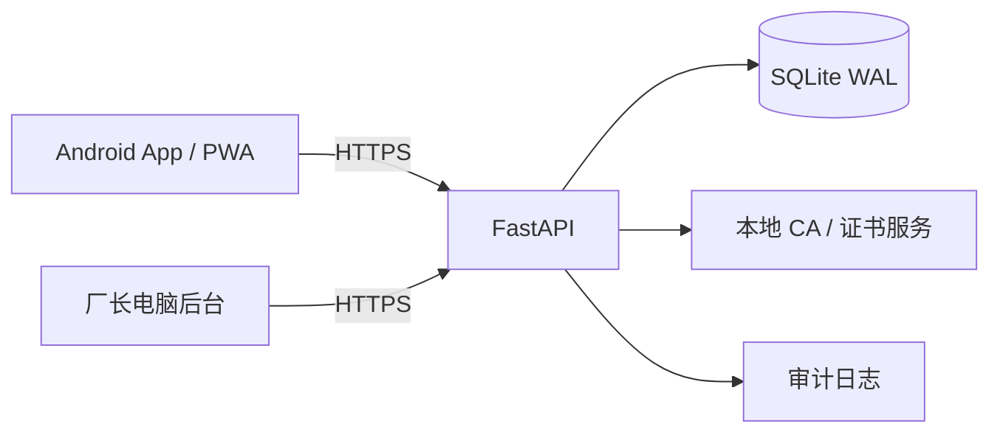
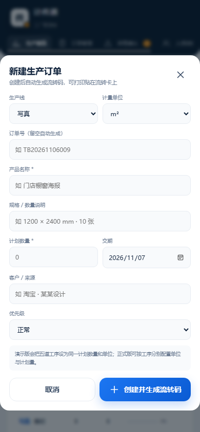

# 计件通 · 工厂计件生产管理系统

这个项目是我独立完成的一套工厂计件系统，从需求梳理、后端、前端、安卓端到现场部署和培训，都是我做的。

它目前在一家 17 人左右的小型工厂实际使用，覆盖写真和亚克力两条产线。系统按 50 人以内的小型工厂场景设计，重点解决三件事：

- 员工报工要快，现场没时间点很多层；
- 多人一起做的工序，数量要算得清；
- 厂长看到的是实际生产进度，不是事后补出来的表。

技术栈：**FastAPI · SQLite · 原生 JavaScript PWA · Android WebView**。

---

## 1. 为什么做这个项目

工厂原来的做法是纸单加 Excel。

员工做完一道工序，在纸上记一笔，月底再由人汇总。人少的时候还能对，人一多就出现几个问题：

- 几个人一起做同一道工序，产量算到谁头上容易有争议；
- 员工不知道自己今天做了多少，要等厂长统计；
- 订单走到哪一道，厂长只能靠问；
- 改单、补单、作废之后，历史记录对不上。

我去现场看了报工流程，发现员工真正需要的不是复杂功能，而是：

```text
扫码 → 选工序 → 报工成功
```

厂长需要的则是：

```text
订单进度、人员产量、异常记录、可追溯
```

所以这个项目从一开始就是按“现场能用”做的，不是做一个看起来完整的后台。

---

## 2. 我负责的范围

这个项目没有拆成前后端两个人，是我独立完成的：

- 去工厂梳理报工、计件、合报和异常流程；
- 设计数据库表和接口；
- 写 FastAPI 后端、权限、报工校验和审计；
- 写 H5/PWA 员工端和厂长端；
- 做 Android WebView 客户端和扫码；
- 处理厂内 HTTPS、证书和手机兼容；
- 打包 Windows 服务器、APK 和交付文档；
- 现场部署、培训和处理使用问题。

---

## 3. 几个关键设计

### 3.1 订单保存路线快照，而不是引用固定工序

最早的版本把写真线写死成 5 道，亚克力线也写死一套流程。

后来发现不同产品路线不一样，有的要覆膜，有的不要；有的最后要特殊加工，有的到切割就结束。只改前端不够，因为历史订单会跟着乱。

最后改成：

```text
routes / route_steps    路线模板，管理员可维护
production_jobs         订单
job_steps               创建订单时复制的工序快照
```

订单创建时把当前路线复制一份到 `job_steps`。以后管理员再改路线，只影响新订单，历史订单还是原来的工序。

这个设计不复杂，但它解决了“改配置不能改历史”的问题。

### 3.2 多人合报：先开组，结束再结算

写真过板、写真综合、亚克力激光切割这几道工序，经常是 2～3 个人一起做。

第一版想得很简单：谁扫码就给谁记一份。结果三个人扫同一道，数量被重复计算了三次。

后来改成合报组：

```text
第一个员工扫码 → 开组
后续员工扫码   → 加入
下一道工序开始 → 自动结束上一道
厂长完成订单   → 结束最后一道
结束时按实际人数平分
```

加入阶段不写正式产量，结束的时候才一次性生成每个人的报工记录。

最后一个人补小数差额，保证总量和订单数量一致。

### 3.3 技能从“第几道”迁移到“工序名称”

旧系统里，员工技能记的是：

```text
写真线，第 3 道
亚克力线，第 4 道
```

新路线之后，同一个“第 3 道”在不同路线里可能不是同一道工序，旧模型就不够用了。

所以增加了按工序名称授权的 `employee_process_skills`，扫码时优先判断工序名称；旧订单没有工序名称时，再回退到旧技能。

迁移的时候保留了旧权限映射，避免升级后员工突然不能报工。

### 3.4 本地 HTTPS 和手机证书

工厂没有公网域名，但手机扫码必须用 HTTPS，否则浏览器不给相机权限。

我做了本地 CA：

```text
服务器生成 CA 和服务器证书
8788 端口提供 CA 下载
安卓首次配置时下载并信任
iPhone 通过描述文件安装
```

这部分在现场花的时间最多。安卓和 iPhone 的证书入口不一样，有些浏览器还会拦截自签证书，所以后来在 APK 里做了自动下载 CA 和首次配置页面。

---

## 4. 系统结构



### 后端

- FastAPI + Uvicorn；
- SQLite，开启 WAL；
- PBKDF2-SHA256 存 PIN；
- Bearer Token 会话；
- 服务端校验技能、数量、重复报工和订单状态。

### 前端

- 原生 JavaScript，没有引入前端框架；
- 员工端和厂长端共用一套页面，按角色渲染；
- PWA 支持添加到主屏幕；
- 二维码生成和扫码库放在本地，断网也能用。

### 安卓

- Java + WebView；
- 原生扫码；
- 首次配置服务器地址和证书；
- 厂长端可以看统计、订单和完成订单。

---

## 5. 界面预览

| 新建订单 | 扫码报工 |
| --- | --- |
|  |  |


> 截图中的姓名和订单信息为演示数据，已做脱敏处理。

---

## 6. 我踩过的坑

### 坑一：只改前端，历史数据会乱

一开始路线写死在前端，改一道工序要同时改好几个文件。后来把路线放进数据库，再给订单做快照，才稳定下来。

### 坑二：合报不能边扫边改已确认的量

如果第一个人扫完就记 30，第二个人加入再改成 15，第三个人加入再改成 10，已经确认的记录会反复变化。

最后改成“结束才结算”，加入阶段只记录参与人。

### 坑三：手机证书不是装一次就完事

安卓、iPhone、不同浏览器对本地证书的处理都不一样。后来把证书下载、服务器地址配置和首次连接做成引导流程，现场才好交付。

### 坑四：管理端和员工端不能共用同一套权限假设

厂长能看所有订单，员工只能看自己的记录；厂长能改路线，员工不能。权限必须在服务端校验，不能只靠前端隐藏按钮。

---

## 7. 现在实现了什么

### 员工端

- 工号 + PIN 登录；
- 扫码报工，自动带出订单和数量；
- 按工序技能显示可报工序；
- 多人合报加入；
- 我的今日/本月产量；
- 我的报工记录；
- 订单进度查看；
- PWA 添加到主屏幕。

### 厂长端

- 生产概览；
- 订单创建、修改、作废、完成；
- 订单路线和工序进度；
- 员工新增、改名、停用；
- 工序技能授权；
- 工序和路线管理；
- 合报参与人和结束岗位；
- 审计记录。

### 数据规则

- 计量单位独立保存，平方米、件、套不混加；
- 同一人、同一订单、同一工序防止重复报工；
- 已报工订单不能直接改米数；
- 作废订单保留历史记录；
- 关键操作写审计日志。

---

## 8. 如何运行

### 环境

- Python 3.11+
- Windows / macOS / Linux

### 启动

```bash
python -m venv .venv

# Windows
.venv\Scripts\activate
# macOS / Linux
source .venv/bin/activate

pip install -r server/requirements.txt
python -m server.main
```

默认访问：

```text
https://127.0.0.1:8443/
```

首次启动会在 `data/` 生成 SQLite 数据库，在 `certs/` 生成本地 HTTPS 证书。

管理员密码和员工 PIN 不会提交到仓库。

### 测试

```bash
pip install -r requirements-dev.txt
pytest
```

### 安卓

用 Android Studio 打开 `android-app/`，配置服务器地址后编译。

---

## 9. 项目结构

```text
.
├─ app/                 H5 / PWA 前端
│  ├─ app.js            交互、API、弹窗
│  ├─ core.js           数据模型、业务计算
│  ├─ pages-worker.js   员工端页面
│  ├─ pages-main.js     管理端页面
│  └─ vendor/           二维码、扫码库
├─ server/              FastAPI 后端
│  ├─ main.py           API 与静态页面
│  ├─ service.py        订单、报工、合报、路线
│  ├─ db.py             SQLite schema 与迁移
│  └─ security.py       PIN 哈希、会话
├─ android-app/         安卓 WebView 客户端
├─ tools/               构建、备份、证书、打包脚本
├─ tests/               Pytest 测试
├─ docs/                设计图与界面预览
├─ Dockerfile
├─ docker-compose.yml
└─ .env.example
```

---

## 10. 当前限制

- SQLite 适合单厂、小规模并发，不是多工厂 SaaS；
- 本地证书方案对 iPhone 不够友好，后续更适合上域名 HTTPS；
- 手机端和电脑端的管理功能还没有完全对齐；
- 暂未接入微信登录、对象存储和消息通知；
- 目前是 17 人左右的试点规模，不是大规模生产验证。

这些限制我没有藏起来，因为下一步要做的事情很清楚：

- 用 Cloudflare Tunnel 或域名 HTTPS 解决 iPhone；
- 把工序、路线、技能配置统一成一套可配置字典；
- 增加离线队列和照片证据；
- 多工厂场景迁移到 PostgreSQL。

---

## 11. 说明

这个项目不是课程作业，也不是只做了页面的 Demo。

它真正处理过：

- 工厂现场报工；
- 多人合报平分；
- 旧数据迁移；
- 安卓/iPhone 证书；
- Windows 本地部署；
- 客户数据备份和交付。

仓库里的截图和数据都是演示或脱敏内容，不包含客户账号、证书私钥和生产数据。
